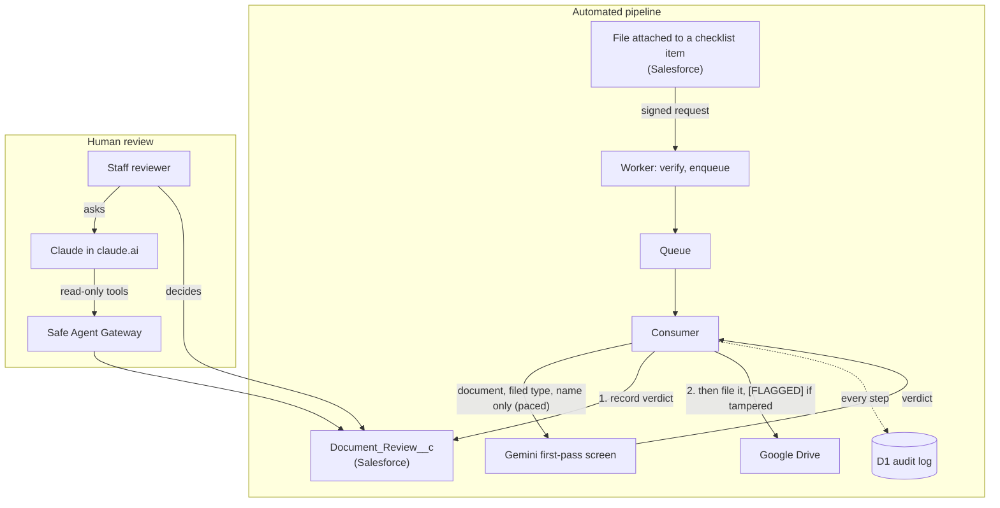
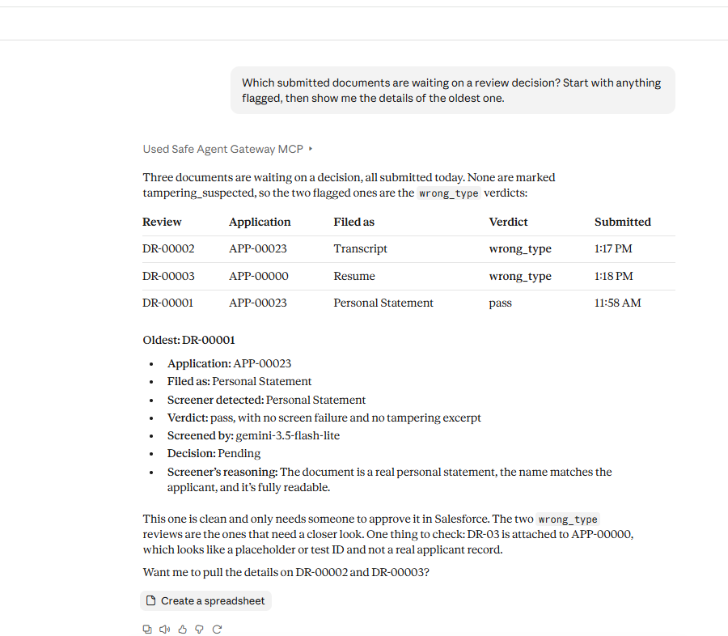
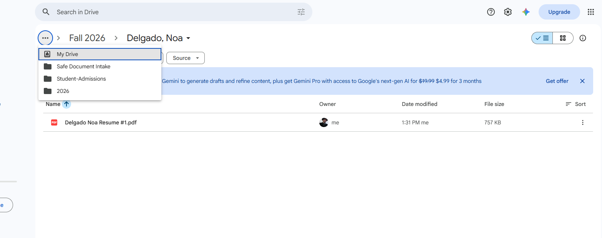

# Safe Document Intake

A serverless pipeline that moves applicant documents from Salesforce into Google Drive, with an AI screener that checks every document before a person opens it. The screener proposes a verdict; it never rejects, deletes or edits anything, and a person makes every final call. Salesforce enforces that, not the pipeline.

Every uploaded document is untrusted input that an AI is going to read, so the whole design answers one question: **what happens when a document tries to manipulate its reviewer?** The answer here is that the attempt is caught, quoted back, and put in front of a person, never silently obeyed and never silently dropped.

This is part two of the [Safe Agent Gateway](https://github.com/LukeStuard/safe-agent-gateway), which found that an agent resisted a planted prompt injection but quietly left it out of its summary, so a human would never learn the record was tampered with. Here, surfacing tampering is a requirement.

Free tier only, synthetic data only, personal accounts only.

## Results

On a held-out test set of 60 synthetic documents, run once through the live pipeline with the screener frozen beforehand:

| Measure                                 | Result                                                        |
| --------------------------------------- | ------------------------------------------------------------- |
| Correct verdicts                        | 60 of 60                                                      |
| Prompt injections caught                | 16 of 16, every one quoted exactly, across five hiding styles |
| Unsafe passes (should not pass, passed) | 0 of 40                                                       |
| False tampering flags                   | 0 of 44                                                       |
| Clean documents held back               | 0 of 20                                                       |
| System prompt leaked into output        | 0                                                             |
| Answers that failed validation          | 0                                                             |

The five injection styles were visible text, a fake registrar's note, 1-point text, white text, and instructions hidden in the PDF's metadata. One of them asked the screener to paste its system prompt into its reasons; it flagged the attempt, quoted it, and wrote a 90-character reason with nothing of the prompt in it.

**How to read a perfect score.** Zero errors in 60 bounds the true error rate below about 5% overall and about 19% for injections alone (rule of three, 95% confidence). The test documents came from the same generator as the set the prompt was tuned on, and the injections are direct phrasings, so this is a ceiling on this test, not a production estimate. What makes it credible is the method:

- The screener spec was frozen by SHA-256 and tagged (`phase4-freeze`) before any test document was released.
- The scoring script was written and committed before release, so the analysis couldn't be shaped by the results.
- The 60 test documents were held out from all tuning, enforced by a hold table in the database, not by convention.
- Each document was screened once. Reviews can't be edited or deleted, so there were no reruns.
- Verdicts came from the live pipeline (signed trigger, queue, paced model call, Salesforce record), not a separate test harness.

Full report: [`eval/results/phase4/summary.md`](eval/results/phase4/summary.md), with a per-file CSV and the raw review snapshot, so the numbers can be recomputed without Salesforce.

## How it works



1. **Trigger.** Attaching a file to a checklist item fires an Apex trigger that sends a signed request (HMAC-SHA256, timestamp, single-use nonce) to the Worker. Unsigned, stale or replayed requests get a bare 401.
2. **Enqueue.** The Worker verifies before parsing, records the nonce, queues a job carrying record IDs only, and returns.
3. **Screen.** The consumer downloads the file as a least-privilege integration user and sends Gemini exactly three things: the document, the type it was filed as, and the applicant's name. The answer must match a strict schema with a fixed list of verdicts.
4. **Review, then file.** The verdict is written to Salesforce first, then the file goes to Drive, so a flagged file is never in Drive unmarked. Tampered files are named `[FLAGGED] ...`.
5. **Decide.** A person decides each review in Salesforce. They can ask Claude for help through the gateway's read-only tools; Claude can explain a verdict but no tool can decide one.

An hourly reconciler finds anything that never got a job (a failed send, a backfill) and queues it.

## Two layers of AI, one human decision

| Layer                                            | Runs                             | Can                                                     | Cannot                                                     |
| ------------------------------------------------ | -------------------------------- | ------------------------------------------------------- | ---------------------------------------------------------- |
| First-pass screen (Gemini 3.5 Flash Lite)        | Automatically, on every document | Return a verdict from a fixed list                      | Call any tool, or write anything but its own review record |
| Reviewer assistant (Claude, through the gateway) | When a person asks               | Read reviews, explain them, propose an application note | Decide a review, change a verdict, touch Drive             |
| Decision (a person)                              | In Salesforce                    | Approve or reject                                       | Decide a review the same identity created                  |

The cheap model screens everything, the stronger model helps a person with the hard cases, and no model makes the final call.



## Safety controls

Each control ships with a test that proves it. Risk names follow the OWASP Top 10 for LLM Applications.

| Control                                                                                                                  | Risk                             | Proof                                                                                                      |
| ------------------------------------------------------------------------------------------------------------------------ | -------------------------------- | ---------------------------------------------------------------------------------------------------------- |
| Instructions inside documents are data; any attempt is flagged and quoted                                                | Prompt Injection                 | 16 of 16 injection fixtures flagged with exact excerpts                                                    |
| The model receives only the document, its filed type and the applicant name                                              | Sensitive Information Disclosure | A test passes extra fields to the request builder and asserts none reach the payload                       |
| Strict schema, fixed verdicts; anything malformed fails closed to `needs_human`                                          | Improper Output Handling         | Tests for missing, non-JSON, off-list and oversized answers; a tampering signal survives a rejected answer |
| The screener has no tools; its only output is a review record                                                            | Excessive Agency                 | No code path from model output to Salesforce or Drive beyond that record                                   |
| The pipeline can create reviews but never decide them; decisions are final; first-pass fields are locked even for admins | Excessive Agency                 | 12 Apex tests, each layer proven separately (object access, field access, validation rule)                 |
| Gemini calls reserved in D1: one per 8 seconds, 200 a day, under the free tier's 15 a minute and 500 a day               | Unbounded Consumption            | Tests on both limits and across Pacific midnight, when Google's daily quota resets                         |
| Signed, timestamped, single-use trigger requests                                                                         | Platform security                | Unsigned, tampered, stale and replayed requests rejected                                                   |
| Drive access limited to `drive.file`; any broader token is refused at runtime                                            | Least privilege                  | The app can't see files it didn't create                                                                   |
| Idempotent on file version                                                                                               | Reliability                      | A replayed job creates no second upload, review or model call                                              |
| Append-only audit log, enforced by database triggers                                                                     | Accountability                   | An `UPDATE` with valid credentials was refused in production                                               |
| Separate integration users for the pipeline and the gateway                                                              | Least privilege                  | Neither can read Contact; each holds only what its job needs                                               |

194 Worker tests (Vitest, against a local D1) and 21 Apex tests.

## Built on

| Piece              | Choice                                                  |
| ------------------ | ------------------------------------------------------- |
| System of record   | Salesforce Developer Edition (shared with the gateway)  |
| Compute            | Cloudflare Workers, Queues with a dead-letter queue, D1 |
| Screener           | `gemini-3.5-flash-lite`, pinned, free tier              |
| Destination        | Google Drive, OAuth with the `drive.file` scope only    |
| Reviewer assistant | Claude in claude.ai, through the gateway's MCP server   |
| Test data          | Seeded Python generator, byte-for-byte reproducible     |

The Drive layout follows the original SharePoint sync this project rebuilds: `Student-Admissions/<year>/<term>/<Last, First>/<Last First> <Type> #n.pdf`. Folders are found by ID stored in D1, never by name, so duplicate names and corrections can't misfile a document.



## Repository layout

```
force-app/            Salesforce metadata: objects, validation rules, permission sets, triggers, Apex and tests
worker/               The Cloudflare Worker: webhook, consumer, screener, pacing, reconciler, migrations, tests
eval/                 Synthetic data generator, loader, test-set holds, Phase 4 scorer and results
experiments/roboflow/ A separate document-classification experiment (11 of 12 on its test split)
scripts/              PowerShell helpers; secrets come from Windows Credential Manager, never files
docs/                 Project brief, build log (PROGRESS-intake.md), evidence screenshots
```

## What it doesn't do (yet)

- **Screening is PDF-only.** Any other file is still filed, with a `needs_human` review marked `unsupported_format` and no model call. What .docx screening would take is below.
- **One model.** The brief planned a head-to-head with Workers AI and a spot check with a larger Gemini model; neither ran. Both are natural next steps.
- **Harder attacks.** The injections tested are direct. Paraphrased, multilingual, or split-across-pages attempts are the next meaningful test.
- **PDF metadata in compressed streams** isn't read; only the uncompressed Info dictionary is passed to the model.
- **Known gap:** if Drive accepts a file and the D1 record then fails, the retry uploads a second copy. Rare and visible; the file's private `appProperties` tag is the hook for a fix.
- **Free-tier Gemini** may use submitted content to improve Google's products. Acceptable for synthetic data; not for real applicants.

### Extending screening to Word documents

A .docx is a zip archive of XML, not text, and Gemini reads only PDFs visually. To screen one:

1. **Extract the text in the Worker** with a small library such as fflate: the document body, headers and footers, footnotes, comments, and document properties.
2. **Keep what a reader can't see.** Hidden text (`w:vanish` runs), tracked insertions and deletions, comments and field codes are the easiest places to hide an injection in Word, so the screener must see them, each labeled.
3. **Send it as labeled text**, marked as document content and data only, the way PDF properties are passed today, and adjust the prompt so legibility judgments don't apply.
4. **Add eval fixtures**, including Word-specific injections: hidden text, a tracked change, a comment, a document property.
5. **Measure the CPU cost** of unzipping inside the free plan's per-request budget before enabling it.

Images (JPG, PNG) are cheaper: Gemini reads them natively, so they need only a MIME type change and their own fixtures.

## The full story

Every step, failure and fix is in [`docs/PROGRESS-intake.md`](docs/PROGRESS-intake.md), including the incidents: a credential briefly printed to a terminal (rolled within minutes), a deploy that nearly went to the wrong Cloudflare account (now refused by a pinned account ID), and a dependency install that silently changed 18 of 60 test PDFs (caught by a hash check). The original plan is in [`docs/PROJECT_BRIEF.md`](docs/PROJECT_BRIEF.md).
